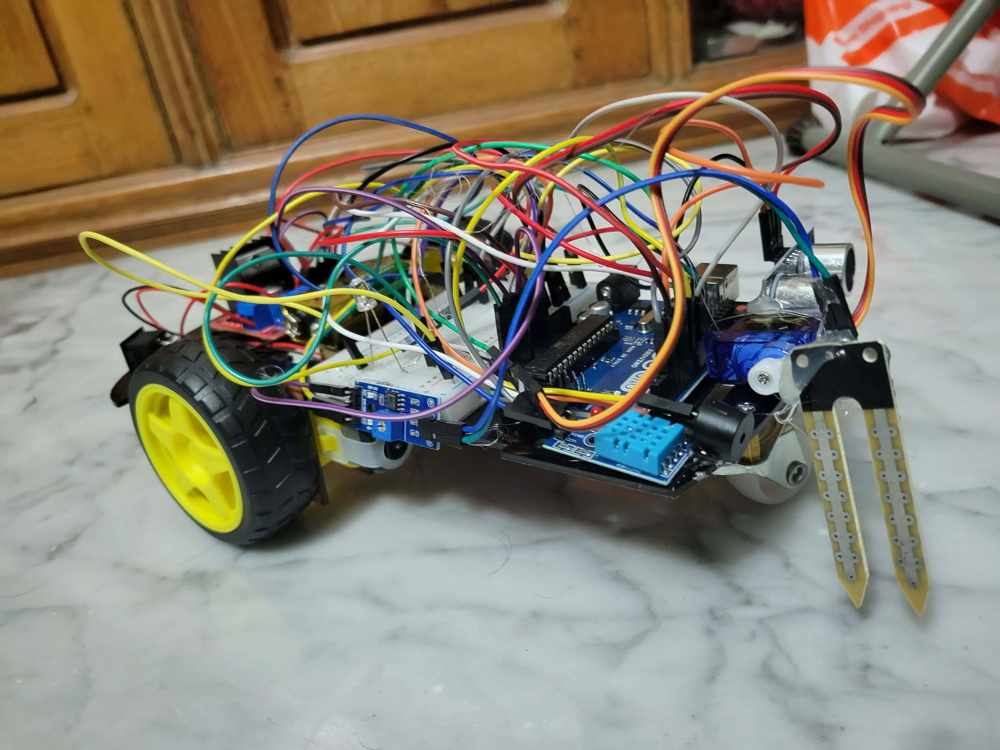
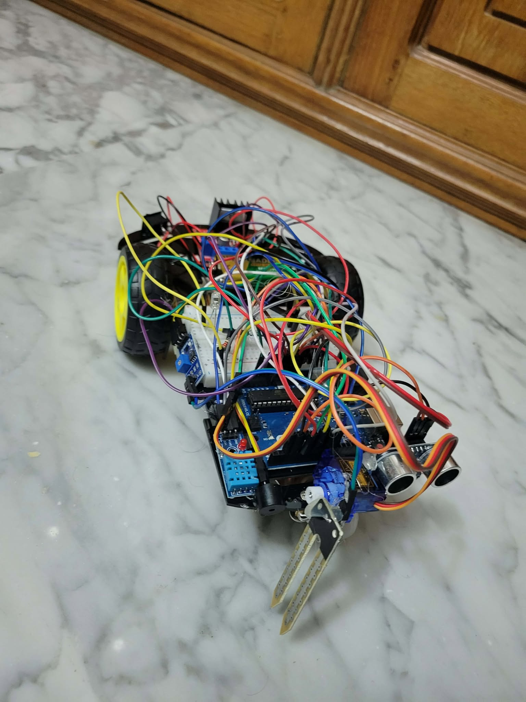

# Autonomous Dengue Breeding Spot Detector Robot

A low-cost autonomous ground robot that patrols rooftops, courtyards and similar areas looking for **stagnant water**, the breeding ground of *Aedes* mosquitoes that spread dengue. When it finds a likely breeding spot, it confirms the reading and raises an audiovisual alert.

Built for **CSE461: Introduction to Robotics Lab**, BRAC University (Spring 2026), Group 1, Section 4.

<p align="center">
  
  
</p>

## Motivation

Bangladesh faces severe dengue outbreaks every monsoon season. In 2023 the country recorded 321,179 cases and 1,705 deaths, the highest on record. Most breeding spots (water on rooftops, in flower pots and in discarded containers) go unnoticed because regular manual inspection doesn't happen. This robot is meant to fill that gap with continuous, unattended surveillance.

## How it works

- **Navigation:** a 2WD differential-drive chassis follows a systematic grid patrol, using wheel encoders for movement and an HC-SR04 ultrasonic sensor to avoid obstacles.
- **Detection by sensor fusion:** readings from a soil moisture sensor, an IR sensor and a DHT11 humidity sensor are combined with **voting logic**, so an alert fires only when the sensors agree. This cuts down on false positives.
- **Confirmation scan:** when a possible hazard is detected, a servo tilts the sensor array for a second scan.
- **Alert:** a confirmed detection flashes an LED and sounds a buzzer, and the robot keeps a count of detections.

## Hardware

| Component | Role |
|---|---|
| Arduino Uno | Main microcontroller |
| L298N motor driver | Drives the wheel motors |
| 2WD chassis with DC motors and wheel encoders | Mobility |
| HC-SR04 ultrasonic sensor | Obstacle detection and distance measurement |
| YL-69 soil moisture sensor | Water detection |
| DHT11 temperature and humidity sensor | Humidity reading for sensor fusion |
| IR sensor | Additional water/surface detection |
| Servo motor | Tilts the sensor array for confirmation scans |
| LED, buzzer, breadboard, resistors, wires | Alerts and wiring |
| Li-ion battery | Power |

## Demo

The initial test run is in [media/videos/initial-test-run.mp4](media/videos/initial-test-run.mp4). Open the file on GitHub and use **View raw** to download or play it.

## Documentation

| Document | Description |
|---|---|
| [Final Project Report](docs/reports/Final-Project-Report.pdf) | Full lab project report |
| [Real-World Implication Report](docs/reports/Real-World-Implication-Report.pdf) | Societal impact, purpose and real-world use |
| [Project Poster](docs/poster/Project-Poster.pdf) | One-page project summary poster |

## Limitations

Navigation currently works only on smooth, flat surfaces.

## Repository structure

```
.
├── docs/
│   ├── poster/          # Project poster
│   └── reports/         # Final report and real-world implication report
├── media/
│   ├── images/          # Photos of the robot
│   └── videos/          # Test run footage
└── README.md
```

## Team

| Name | ID |
|---|---|
| Iftequr Ahmed | 22299172 |
| MD. Nafizul Sadik | 21201313 |
| Fatin Rahman Taseen | 22299002 |
| Sadat Hossain | 22201314 |
| Shafi Ahmed Adib | 23101307 |

Department of Computer Science and Engineering, BRAC University.
